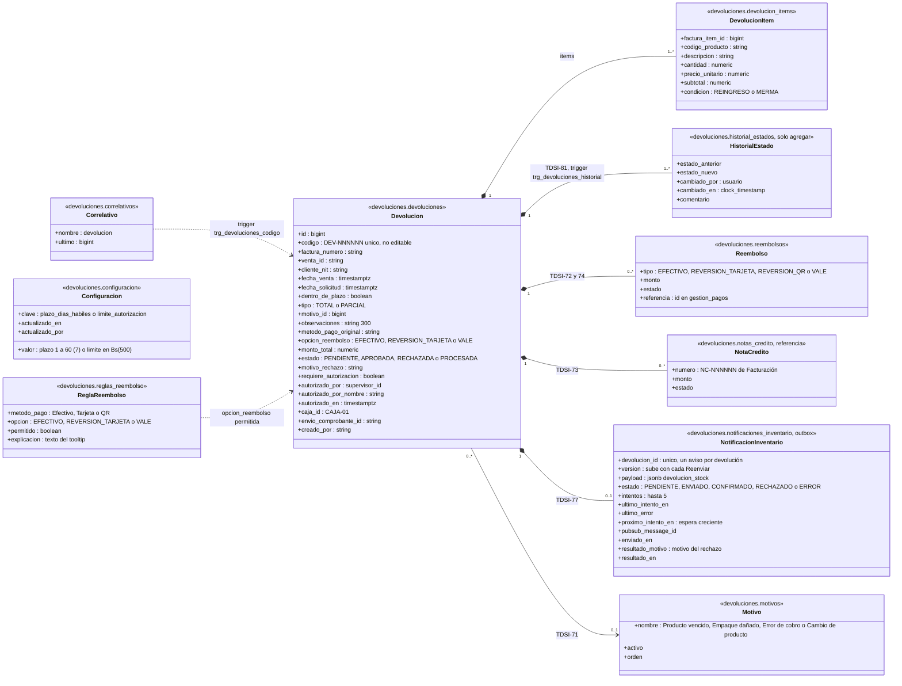

# Diagrama de clases · Microservicio Devoluciones y reembolsos

TDSI-1003 (historia TDSI-70). Microservicio `devoluciones_reembolsos` (puerto 4008), del Encargado de Devoluciones. Muestra cómo se busca el comprobante original en Facturación (TDSI-68), se valida el plazo en días hábiles (TDSI-69) y se registra la devolución con su código `DEV-NNNNNN` (TDSI-70 y TDSI-76). Actualizado en TDSI-1043 con el aviso a Inventario por Pub/Sub (TDSI-77; secuencia en [diagrama-secuencia-inventario.md](diagrama-secuencia-inventario.md)) y en TDSI-1088 con el reporte exportable a Excel (TDSI-82).

Las "clases" son módulos de Node.js (CommonJS): cada uno exporta funciones y recibe lo que necesita por `require`. Las entidades de abajo son las tablas del esquema `devoluciones` (`sql/script_devoluciones.sql`).

## Capas

```mermaid
classDiagram
    direction LR

    class DevolucionesRoutes {
        <<router /api/devoluciones>>
        +GET / ?codigo&estado&desde&hasta
        +GET /del-dia ?fecha
        +POST /
        +GET /:codigo
        +GET /:codigo/historial
        +POST /:codigo/rechazo
        +POST /:codigo/nota-credito
        +POST /:codigo/procesar
        +POST /:codigo/inventario/reenviar
    }
    class ComprobantesRoutes {
        <<router /api/devoluciones/comprobantes>>
        +GET / ?q
        +GET /:numero
        +GET /:numero/plazo
        +GET /:numero/opciones-reembolso
    }
    class ConfiguracionRoutes {
        <<router /api/devoluciones/configuracion>>
        +GET /plazo
        +GET /limite-autorizacion
    }
    class ReportesRoutes {
        <<router /api/devoluciones/reportes>>
        +GET /filtros
        +GET / ?desde&hasta&sucursal&estado&motivo_id&metodo
        +GET /excel ?mismos filtros
    }
    class MotivosRoutes {
        <<router /api/devoluciones/motivos>>
        +GET /
    }

    class RegistroService {
        +registrarDevolucion(body) DetalleDevolucion
        +validarPedido(body) Pedido
        +construirDevolucion(factura, pedido, plazo, yaDevuelto) NuevaDevolucion
    }
    class NotaCreditoService {
        +emitirNotaCreditoDeDevolucion(codigo, usuario) NotaCredito
    }
    class RechazoService {
        +rechazarDevolucion(codigo, motivo, usuario) DetalleDevolucion
        +verificarRechazable(devolucion, cliente)
    }
    class ProcesoService {
        +procesarDevolucion(codigo, body) DetalleDevolucion
    }
    class InventarioService {
        +armarMensaje(devolucion, items, version) DevolucionStock
        +mensajeId(codigo, version) DEV-NNNNNN-v
        +intentarEnvio(notificacion) NotificacionInventario
        +enviarSeguro(id, payload) NotificacionInventario
        +estadoInventario(notificacion) EstadoInventario
        +reenviar(codigo) NotificacionInventario
    }
    class AcusesInventarioService {
        +interpretar(texto) Acuse
        +procesarMensaje(mensaje) ResultadoAcuse
    }
    class ReintentoInventarioJob {
        <<job cada 15 s>>
        +procesarPendientes() NotificacionInventario[]
        +iniciar()
    }
    class AcusesInventarioJob {
        <<job cada 30 s>>
        +procesarAcuses() ResultadoAcuse[]
        +iniciar()
    }
    class ReportesService {
        +MAX_DIAS = 366
        +validarFiltros(query) Filtros
        +obtenerReporte(query) Reporte
        +opcionesDeFiltros() OpcionesFiltros
    }
    class ReportesExcelService {
        <<exceljs>>
        +generarReporteExcel(reporte) Buffer
        +nombreArchivo(filtros) string
    }
    class DevolucionesService {
        +listarDevoluciones(codigo, estado, desde, hasta) ResumenDevolucion[]
        +obtenerDevolucion(codigo) DetalleDevolucion
        +obtenerHistorial(codigo) LineaDeTiempo
        +devolucionesDelDia(fecha) DevolucionesDelDia
        +aDetalle(fila) DetalleDevolucion
    }
    class ComprobantesService {
        +buscarComprobantes(q) ResultadoBusqueda
        +obtenerComprobante(numero) Comprobante
        +obtenerPlazo(numero) Plazo
        +facturaDisponible(numero) Factura
    }
    class OpcionesReembolsoService {
        +OPCIONES : Efectivo, Reversión electrónica, Vale
        +calcularOpciones(metodos, reglas) Opcion[]
        +opcionesDeFactura(factura) OpcionesReembolso
    }
    class PlazoService {
        +plazoDeComprobante(fechaEmision, plazoDias, hoy) Plazo
    }
    class ConfiguracionService {
        +PLAZO_POR_DEFECTO = 7
        +obtenerPlazoDias() PlazoConfigurado
        +LIMITE_POR_DEFECTO = 500
        +obtenerLimiteAutorizacion() LimiteConfigurado
    }

    class DevolucionesRepo {
        +crear(datos, items) Devolucion
        +registrar(facturaNumero, construir) Devolucion
        +buscarPorCodigo(codigo) Devolucion
        +listar(filtros) Devolucion[]
        +cambiarEstado(codigo, estado, usuario, comentario, validar) Devolucion
        +procesar(codigo, usuario, validar, armarPayload) Procesada
        -insertar(cliente, datos, items)
        -enTransaccion(trabajo)
    }
    class NotificacionesInventarioRepo {
        +obtener(id) NotificacionInventario
        +obtenerPorCodigo(codigo) NotificacionInventario
        +crearEnTransaccion(cliente, devolucionId, payload) id
        +marcarEnviado(id, messageId)
        +registrarFallo(id, fallo, maxIntentos, backoffBase)
        +posponer(id, segundos, motivo)
        +tomarPendientes(limite) NotificacionInventario[]
        +registrarAcuse(id, estado, motivo)
        +prepararReenvio(id) NotificacionInventario
    }
    class PubSubPublisher {
        -INVENTARIO_PUBSUB_TOPIC
        +publicar(mensaje, atributos) ResultadoPublicacion
    }
    class PubSubSubscriber {
        -INVENTARIO_ACUSES_SUBSCRIPTION
        +leer(max, suscripcion) Mensaje[]
        +confirmar(ackIds, suscripcion)
        +liberar(ackIds, suscripcion)
    }
    class ReportesRepo {
        +devoluciones(filtros) Fila[]
        +notasCredito(filtros) Fila[]
    }
    class ConfiguracionRepo {
        +obtener(clave) Configuracion
    }
    class HistorialRepo {
        +listarPorDevolucion(id) HistorialEstado[]
    }
    class ReglasReembolsoRepo {
        +reglasDe(metodos) ReglaReembolso[]
    }
    class MotivosRepo {
        +listarActivos() Motivo[]
        +buscarActivo(id) Motivo
        +listarTodos() Motivo[]
        +buscar(id) Motivo
    }
    class FacturacionClient {
        -FACTURACION_URL
        +buscarFacturas(q) ResultadoFacturacion
        +obtenerFactura(numero) Factura
        +validarSupervisor(supervisor_id, pin) Supervisor
        +emitirNotaCredito(pedido) NotaCredito
        +obtenerNotaCredito(numero) NotaCredito
    }

    class DiasHabiles {
        <<utilidad, America/La_Paz>>
        +diaLocal(fecha) string
        +esHabil(dia) boolean
        +diasHabilesEntre(desde, hasta) number
        +sumarDiasHabiles(dia, n) string
        +evaluarPlazo(fechaEmision, plazoDias, hoy) Plazo
    }
    class CodigoDevolucion {
        <<utilidad>>
        +formatearCodigo(n) string
        +normalizarCodigo(texto) string
    }
    class AppError {
        +message : string
        +status : number
        +detalle : any
    }
    class ErrorHandler {
        <<middleware>>
        +errorHandler(err, req, res, next)
    }
    class Db {
        <<pg Pool>>
        +pool
        +query(sql, params)
    }
    class Facturacion {
        <<microservicio externo :4002>>
        GET /api/facturas/buscar?q
        GET /api/facturas/:numero
        POST /api/supervisores/validar
        POST /api/notas-credito
        GET /api/notas-credito/:numero
    }
    class GooglePubSub {
        <<externo>>
        topico de Inventario : devolucion_stock
        ucb-sis323-sub-a-sub : acuse_devolucion_stock
    }
    class GestionCaja {
        <<microservicio externo :4004>>
        GET /api/caja/devoluciones?fecha
        lee GET /api/devoluciones/del-dia
    }

    DevolucionesRoutes --> DevolucionesService
    DevolucionesRoutes --> RegistroService
    DevolucionesRoutes --> RechazoService
    DevolucionesRoutes --> NotaCreditoService
    NotaCreditoService --> DevolucionesRepo : registrarNotaCredito
    DevolucionesRoutes --> ProcesoService
    DevolucionesRoutes --> InventarioService : reenviar
    ProcesoService --> DevolucionesRepo : procesar (outbox)
    ProcesoService --> InventarioService : armarMensaje y enviarSeguro
    DevolucionesRepo --> NotificacionesInventarioRepo : crearEnTransaccion
    InventarioService --> NotificacionesInventarioRepo
    InventarioService --> PubSubPublisher
    ReintentoInventarioJob --> NotificacionesInventarioRepo : tomarPendientes
    ReintentoInventarioJob --> InventarioService : intentarEnvio
    AcusesInventarioJob --> PubSubSubscriber
    AcusesInventarioJob --> AcusesInventarioService
    AcusesInventarioService --> NotificacionesInventarioRepo : registrarAcuse
    DevolucionesService --> InventarioService : estadoInventario
    PubSubPublisher ..> GooglePubSub : publishMessage
    PubSubSubscriber ..> GooglePubSub : pull, ack
    NotaCreditoService --> FacturacionClient : emitirNotaCredito
    RechazoService --> DevolucionesRepo : cambiarEstado con validar
    RechazoService --> DevolucionesService : obtenerDevolucion
    ComprobantesRoutes --> ComprobantesService
    ConfiguracionRoutes --> ConfiguracionService
    MotivosRoutes --> MotivosRepo
    ReportesRoutes --> ReportesService
    ReportesRoutes --> ReportesExcelService : excel
    ReportesService --> ReportesRepo
    ReportesService --> MotivosRepo : buscar, listarTodos
    ReportesService --> DevolucionesService : limiteDelDia, ESTADOS
    ReportesService --> OpcionesReembolsoService : OPCIONES

    RegistroService --> ComprobantesService : facturaDisponible
    RegistroService --> PlazoService
    RegistroService --> MotivosRepo : buscarActivo
    RegistroService --> ConfiguracionService : limite
    RegistroService --> FacturacionClient : validarSupervisor sobre el limite
    RegistroService --> OpcionesReembolsoService : opcion permitida
    ComprobantesService --> OpcionesReembolsoService
    OpcionesReembolsoService --> ReglasReembolsoRepo
    RegistroService --> DevolucionesRepo : registrar
    RegistroService --> DevolucionesService : aDetalle
    DevolucionesService --> DevolucionesRepo
    DevolucionesService --> HistorialRepo
    DevolucionesService --> CodigoDevolucion
    ComprobantesService --> FacturacionClient
    ComprobantesService --> PlazoService
    ComprobantesService --> ConfiguracionService
    PlazoService --> DiasHabiles
    PlazoService --> ConfiguracionService
    ConfiguracionService --> ConfiguracionRepo

    DevolucionesRepo --> Db
    ConfiguracionRepo --> Db
    MotivosRepo --> Db
    ReglasReembolsoRepo --> Db
    HistorialRepo --> Db
    ReportesRepo --> Db
    NotificacionesInventarioRepo --> Db
    FacturacionClient ..> Facturacion : HTTP
    GestionCaja ..> DevolucionesRoutes : HTTP del-dia

    RegistroService ..> AppError : lanza
    RechazoService ..> AppError : lanza
    ComprobantesService ..> AppError : lanza
    ReportesService ..> AppError : lanza
    DevolucionesService ..> AppError : lanza
    FacturacionClient ..> AppError : lanza
    ErrorHandler ..> AppError : responde status y mensaje
```

## Entidades (esquema `devoluciones`)

## Reglas que viven en la base de datos

| Regla | Dónde |
|---|---|
| El código `DEV-NNNNNN` lo pone la BD al insertar, seguido y sin huecos | trigger `trg_devoluciones_codigo` + tabla `correlativos` (TDSI-229) |
| El código es único, con formato fijo y no se puede editar | `UNIQUE`, `CHECK devoluciones_codigo_formato` y trigger `trg_devoluciones_codigo_inmutable` (TDSI-1111) |
| El plazo es un entero de 1 a 60 | `CHECK configuracion_plazo_valido` (TDSI-1097) |
| El límite de autorización es un monto mayor a 0 | `CHECK configuracion_limite_valido` (TDSI-237) |
| Una opción de reembolso bloqueada siempre explica por qué | `CHECK (permitido OR explicacion IS NOT NULL)` en `reglas_reembolso` (TDSI-221) |
| Las observaciones tienen hasta 300 caracteres | `VARCHAR(300)`; el servicio responde 400 antes de llegar a la BD (TDSI-1009) |
| Cada cambio de estado queda en el historial, con usuario y hora | trigger `trg_devoluciones_historial` (TDSI-1057) |
| El historial no se puede editar ni borrar (solo se va si se borra la devolución completa) | triggers `trg_historial_inmutable` y `trg_historial_sin_truncate`, SQLSTATE DV002 (TDSI-239) |
| Una devolución RECHAZADA no genera reembolso, nota de crédito ni aviso a Inventario | triggers `trg_*_no_rechazada` en `reembolsos`, `notas_credito` y `notificaciones_inventario`, SQLSTATE DV003 (TDSI-1116) |
| No se rechaza una devolución procesada o con reembolso / nota de crédito emitidos | `RechazoService.verificarRechazable` dentro de la transacción, con la devolución bloqueada (TDSI-1116) |
| Una devolución tiene un solo aviso a Inventario; reintentos y Reenviar reusan la misma fila | `uq_notificacion_inventario_devolucion` (TDSI-231) |
| Dos instancias del servicio no envían el mismo aviso | `tomarPendientes` con `FOR UPDATE SKIP LOCKED` (TDSI-1039) |
| No se devuelve dos veces la misma unidad | `DevolucionesRepo.registrar` bloquea la factura con `pg_advisory_xact_lock` mientras suma lo ya devuelto (TDSI-1001) |

La nota de crédito (con su PDF y su envío a Contabilidad) la emite Facturación (`facturacion.notas_credito`, TDSI-73; ver `facturacion/docs/diagrama-secuencia-nota-credito.md`): Devoluciones guarda solo su número en `devoluciones.notas_credito`.

Los vales, la reversión con tarjeta y el correo del comprobante los hace `gestion_pagos` (acuerdo de equipo, contrato TDSI-1027): Devoluciones solo guarda la referencia (`reembolsos.referencia`, `devoluciones.envio_comprobante_id`).

El aviso a Inventario (TDSI-77) va por Google Pub/Sub con bandeja de salida, reintentos y acuse: ver [diagrama-secuencia-inventario.md](diagrama-secuencia-inventario.md) y el contrato con el grupo de Inventario en [contrato-inventario.md](contrato-inventario.md).
