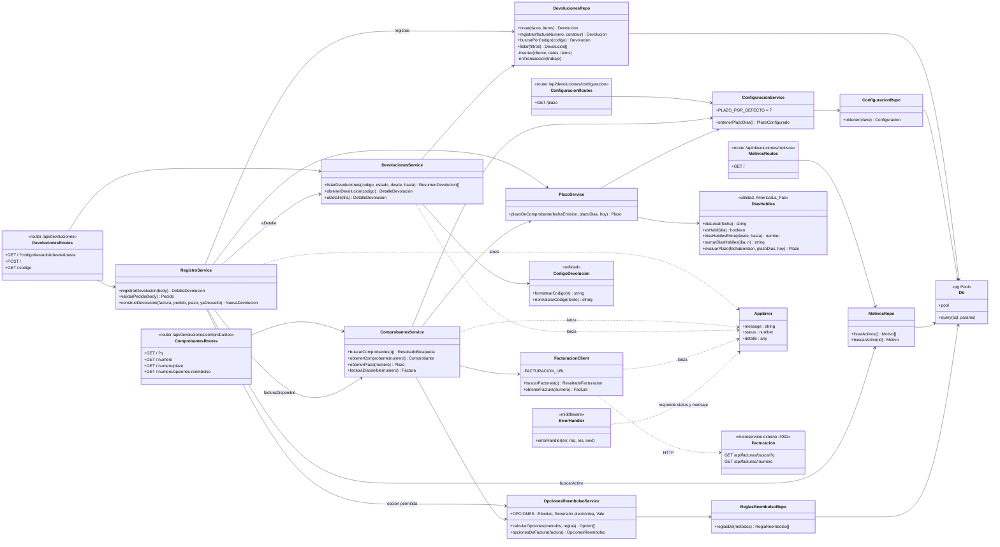
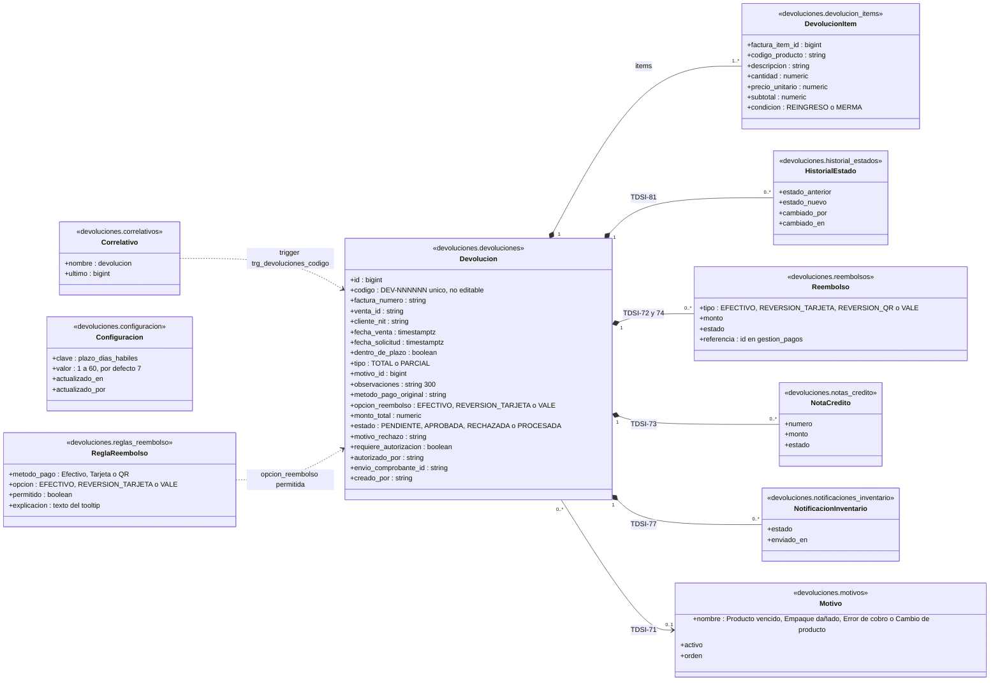

# Diagrama de clases · Microservicio Devoluciones y reembolsos

TDSI-1003 (historia TDSI-70). Microservicio `devoluciones_reembolsos` (puerto 4008), del Encargado de Devoluciones. Muestra cómo se busca el comprobante original en Facturación (TDSI-68), se valida el plazo en días hábiles (TDSI-69) y se registra la devolución con su código `DEV-NNNNNN` (TDSI-70 y TDSI-76).

Las "clases" son módulos de Node.js (CommonJS): cada uno exporta funciones y recibe lo que necesita por `require`. Las entidades de abajo son las tablas del esquema `devoluciones` (`sql/script_devoluciones.sql`).

## Capas

## Entidades (esquema `devoluciones`)

## Reglas que viven en la base de datos

| Regla | Dónde |
|---|---|
| El código `DEV-NNNNNN` lo pone la BD al insertar, seguido y sin huecos | trigger `trg_devoluciones_codigo` + tabla `correlativos` (TDSI-229) |
| El código es único, con formato fijo y no se puede editar | `UNIQUE`, `CHECK devoluciones_codigo_formato` y trigger `trg_devoluciones_codigo_inmutable` (TDSI-1111) |
| El plazo es un entero de 1 a 60 | `CHECK configuracion_plazo_valido` (TDSI-1097) |
| Una opción de reembolso bloqueada siempre explica por qué | `CHECK (permitido OR explicacion IS NOT NULL)` en `reglas_reembolso` (TDSI-221) |
| Las observaciones tienen hasta 300 caracteres | `VARCHAR(300)`; el servicio responde 400 antes de llegar a la BD (TDSI-1009) |
| No se devuelve dos veces la misma unidad | `DevolucionesRepo.registrar` bloquea la factura con `pg_advisory_xact_lock` mientras suma lo ya devuelto (TDSI-1001) |

Los vales, la reversión con tarjeta y el correo del comprobante los hace `gestion_pagos` (acuerdo de equipo, contrato TDSI-1027): Devoluciones solo guarda la referencia (`reembolsos.referencia`, `devoluciones.envio_comprobante_id`).
