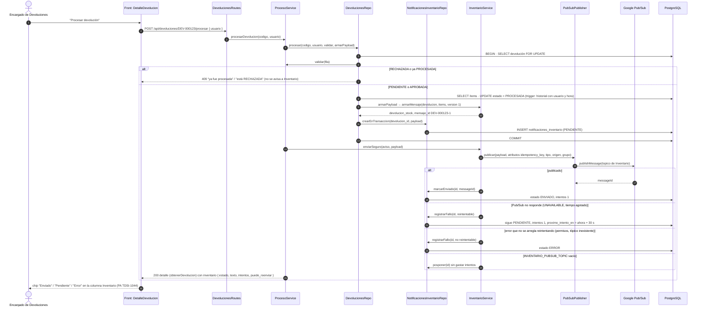
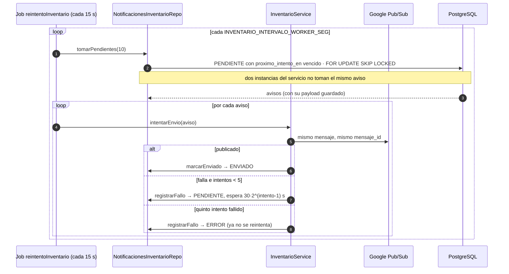
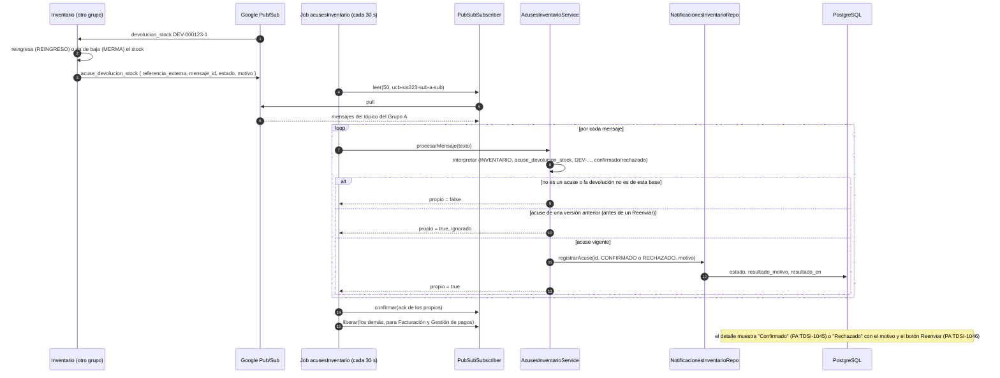
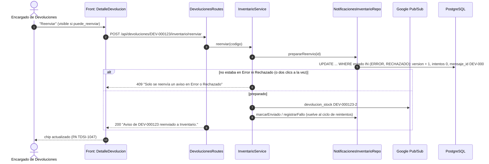
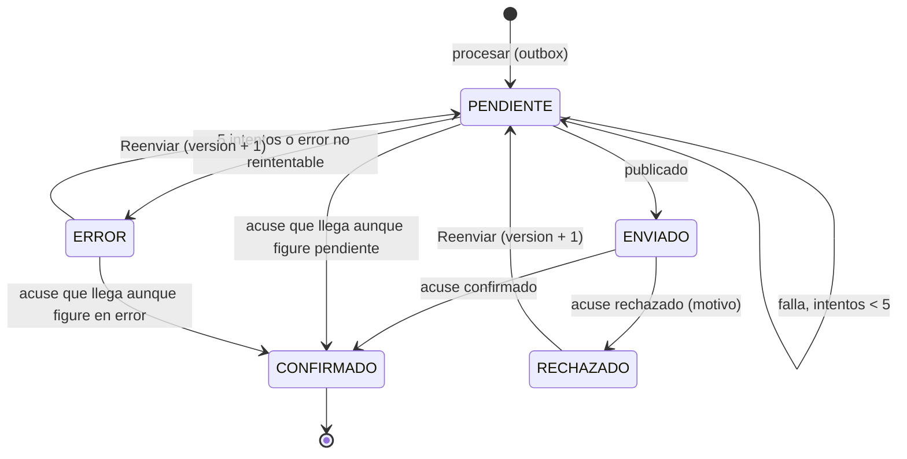

# Diagrama de secuencia · Aviso a Inventario por Pub/Sub

TDSI-1043 (historia TDSI-77). Qué pasa desde que el Encargado de Devoluciones da por **procesada** una devolución hasta que Inventario confirma (o rechaza) el reingreso o la baja de los productos. Los nombres son los módulos reales de `devoluciones_reembolsos` (ver [diagrama-clases.md](diagrama-clases.md)); el formato de los mensajes está en [contrato-inventario.md](contrato-inventario.md).

Ideas clave:

- **Bandeja de salida (outbox).** El cambio a `PROCESADA` y el aviso (`PENDIENTE`, con el mensaje ya armado) se guardan en la misma transacción. Recién después se publica: si Pub/Sub falla, la devolución igual queda procesada y el aviso no se pierde.
- **Reintentos.** Un worker reintenta los avisos pendientes hasta 5 veces, con espera creciente (30, 60, 120 y 240 s). Después el aviso queda en `ERROR` y se puede **Reenviar**.
- **Idempotencia.** Una devolución tiene un solo aviso. Cada envío lleva `mensaje_id = DEV-<codigo>-<version>` (también en el atributo `idempotency_key`): los reintentos repiten el mismo, y **Reenviar** sube la versión para que Inventario lo tome como un aviso nuevo.
- **Acuses.** Inventario responde en el tópico del Grupo A. La suscripción la comparten Facturación y Gestión de pagos, así que cada servicio confirma (ack) solo lo suyo y libera lo demás.

## 1. Procesar la devolución y publicar el aviso (TDSI-231)

## 2. Reintentos del worker (TDSI-1039)

## 3. Acuse de Inventario (TDSI-1040)

## 4. Reenviar (TDSI-1041)

## Estados del aviso

