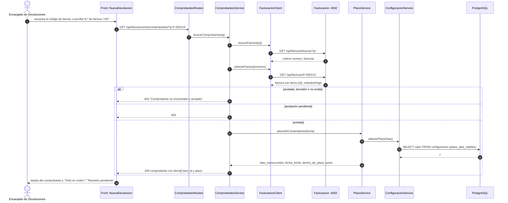
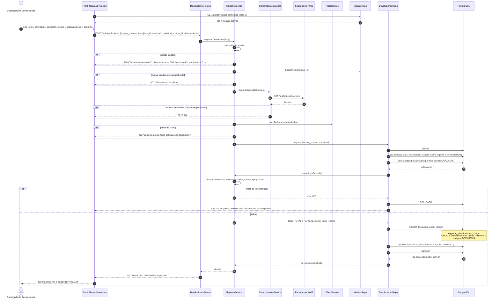

# Diagrama de secuencia · Registrar devolución

TDSI-1004 (historia TDSI-70). Qué pasa desde que el Encargado de Devoluciones busca el comprobante hasta que la devolución queda registrada con su código `DEV-NNNNNN`. Los nombres son los módulos reales de `devoluciones_reembolsos` (ver [diagrama-clases.md](diagrama-clases.md)).

El motivo y las observaciones (TDSI-71) ya están en el flujo. La opción de reembolso (TDSI-72) y la autorización del supervisor sobre el límite (TDSI-80) se suman en sus historias.

## 1. Buscar el comprobante y ver el plazo (paso 1 de "Nueva devolución")

## 2. Registrar la devolución

## Notas

- Si algo falla después del `INSERT` (por ejemplo un ítem inválido), el `ROLLBACK` deshace también el correlativo: no quedan huecos en los códigos `DEV-`.
- El bloqueo es por factura: dos devoluciones de facturas distintas se registran en paralelo; dos de la misma factura, una después de la otra, así nunca se devuelve dos veces la misma unidad.
- El código no se puede editar después (trigger `trg_devoluciones_codigo_inmutable`, TDSI-1111).
