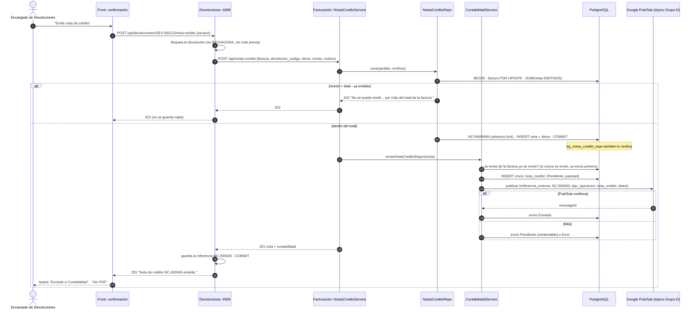
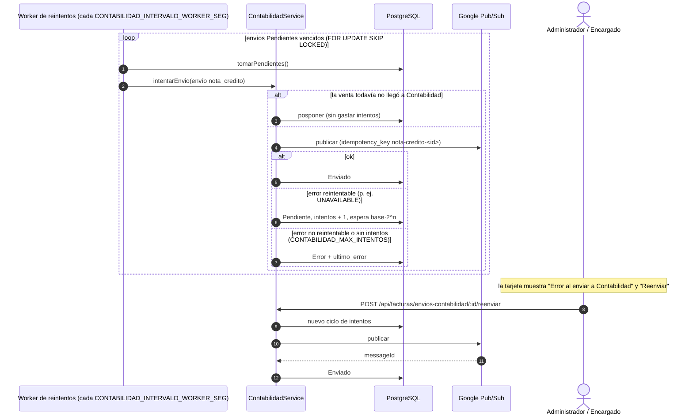
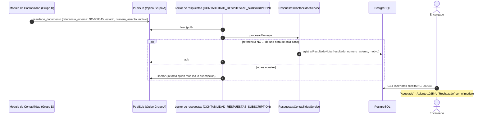

# Diagrama de secuencia · Nota de crédito → Pub/Sub → Contabilidad

TDSI-1020 (historia TDSI-73). Cómo se emite la nota de crédito de una devolución, cómo llega al Módulo de Contabilidad (Grupo D) por Google Pub/Sub y cómo vuelve el acuse con el número de asiento, incluidos los reintentos y el error.

La nota de crédito es un documento de **Facturación** (un dato, un dueño): Devoluciones la pide y guarda solo su número. El envío reutiliza lo mismo que las facturas (TDSI-22/52): la tabla `facturacion.factura_envios_contabilidad`, el publicador, el worker de reintentos y el "Reenviar".

## 1. Emitir y publicar

## 2. Reintentos y error

## 3. Acuse de Contabilidad

## Estados que ve la tarjeta "Nota de crédito"

| Envío | Resultado | Texto |
|---|---|---|
| sin envío (sin tópico) | — | No enviado a Contabilidad |
| Pendiente | — | Enviando a Contabilidad |
| Enviado | — | Enviado a Contabilidad |
| Enviado | aceptado | Aceptado (con N.º de asiento) |
| Enviado | rechazado | Rechazado (con el motivo) |
| Error | — | Error al enviar a Contabilidad · botón "Reenviar" |
