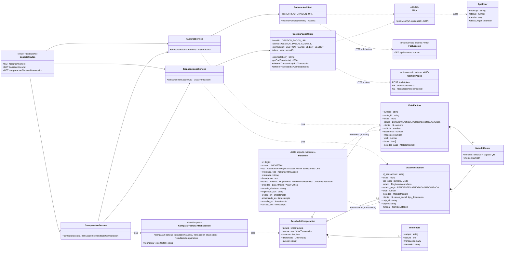

# Diagrama de clases · Microservicio Soporte

TDSI-974 (historia TDSI-63). Muestra cómo el Usuario de Soporte consulta en **solo lectura** la factura (Facturación) y la transacción (Gestión de pagos), las compara y marca las diferencias. `Incidente` es la tabla `soporte.incidentes` (TDSI-971) donde se registra el hallazgo.

Las "clases" son módulos de Node.js: cada `crearX()` es una fábrica que recibe sus dependencias, así en los tests se reemplazan por datos simulados.

## Cómo leerlo

| Capa | Archivo | Responsabilidad |
|---|---|---|
| Rutas | `src/routes/soporteRoutes.js` | Recibe la petición y responde `{ ok, data }`; los errores van al `errorHandler` |
| Servicios | `src/services/*.js` | Validan la entrada (número de factura, ID de transacción) y arman la vista de solo lectura |
| Dominio | `src/domain/compararFacturaYTransaccion.js` | Reglas de comparación, sin base de datos ni red (TDSI-972, probadas en TDSI-973) |
| Clientes | `src/clients/*.js` | Llaman por HTTP a Facturación y Gestión de pagos; traducen sus fallas a `AppError` (404, 502, 503) |
| Base de datos | `sql/script_soporte.sql` | Tabla `incidentes`, la única que escribe Soporte |

Soporte **no** guarda copias de facturas ni de pagos: el incidente solo guarda la referencia (`referencia_tipo` + `referencia`) y los datos se vuelven a leer de sus dueños cuando se necesitan.
