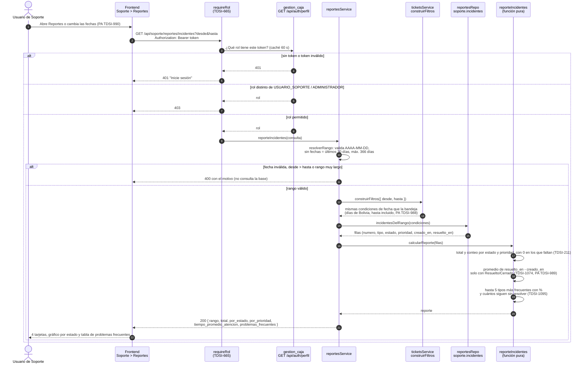

# Diagrama de secuencia · Generar reporte de incidencias

TDSI-987 (historia TDSI-67). El Usuario de Soporte elige un rango de fechas en la pantalla **Soporte > Reportes** (TDSI-212). El microservicio Soporte lee sus incidentes y devuelve:
- los totales por estado y por prioridad (TDSI-211);
- el tiempo promedio de atención (TDSI-1074);
- los problemas más frecuentes (TDSI-1095).

Soporte solo lee su propia tabla `soporte.incidentes`. No llama a Facturación ni a Gestión de pagos, y el reporte no escribe nada.



## Respuesta

```json
{
  "ok": true,
  "data": {
    "rango": { "desde": "2026-11-01", "hasta": "2026-11-26", "dias": 26 },
    "total": 4,
    "por_estado": [
      { "estado": "Abierto", "cantidad": 1 }, { "estado": "En proceso", "cantidad": 0 },
      { "estado": "Pendiente", "cantidad": 0 }, { "estado": "Resuelto", "cantidad": 1 },
      { "estado": "Cerrado", "cantidad": 1 }, { "estado": "Escalado", "cantidad": 1 }
    ],
    "por_prioridad": [
      { "prioridad": "Baja", "cantidad": 1 }, { "prioridad": "Media", "cantidad": 1 },
      { "prioridad": "Alta", "cantidad": 1 }, { "prioridad": "Critica", "cantidad": 1 }
    ],
    "tiempo_promedio_atencion": { "incidentes_resueltos": 2, "promedio_minutos": 180, "promedio_horas": 3, "texto": "3 h" },
    "problemas_frecuentes": [
      { "posicion": 1, "tipo": "Pagos", "cantidad": 3, "sin_resolver": 1, "porcentaje": 75 },
      { "posicion": 2, "tipo": "Acceso", "cantidad": 1, "sin_resolver": 1, "porcentaje": 25 }
    ]
  }
}
```

## Reglas

| Regla | Dónde |
|---|---|
| Un incidente entra al reporte por su **fecha de creación**, en días de Bolivia; `desde` y `hasta` incluidos | `ticketsService.construirFiltros` (la misma de la bandeja) |
| Sin fechas: últimos 30 días hasta hoy. Con una sola: 30 días desde/hasta esa. Máximo 366 días | `reportesService.resolverRango` |
| `por_estado` y `por_prioridad` traen **todos** los valores, también los que están en 0, y suman `total` | `reporteIncidentes.calcularReporte` |
| El promedio solo usa incidentes **Resuelto** o **Cerrado** con `resuelto_en`. Si se reabre, `resuelto_en` se borra (TDSI-693) y deja de contar. Sin resueltos: `promedio_minutos: null` | `reporteIncidentes.tiempoPromedioAtencion` |
| Problemas frecuentes = tipo del incidente. Hasta 5, de mayor a menor; en empate, primero el que tiene más sin resolver y luego por nombre | `reporteIncidentes.problemasFrecuentes` |
